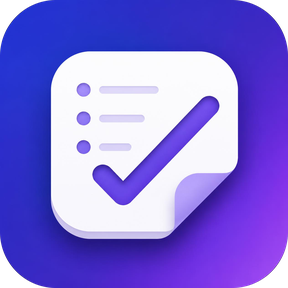

<p align="center">
  
</p>

<h1 align="center">Taskora</h1>

<p align="center">A free, open-source to-do list app for Android. Offline, no account, no ads.</p>

<p align="center">
  
</p>

---

## Features

- **Lists**: organize tasks into color-coded lists, with an Inbox that is always there.
- **Tasks**: notes, due dates with optional times, priorities (low, medium, high) and subtasks.
- **Reminders**: notifications with **Complete** and **Snooze** buttons. They are rescheduled after a reboot.
- **Recurring tasks**: daily, weekly (on chosen days), monthly or yearly, every *n* days, weeks, months or years. Completing one creates the next.
- **Search and filters**: search titles and notes across all lists, and filter by status, list, priority or due date.
- **Sorting**: each list sorts by date created, due date, priority or title.
- **Home screen widget**: shows what's due today or overdue, and you can tick tasks off without opening the app.
- **Themes**: dark by default, with a light theme or follow-system option, and optional wallpaper colors on Android 12+.
- **Private by design**: everything stays on your device. There are no accounts, no network access and no tracking.

## Requirements

- Android 8.0 (API 26) or newer

Taskora isn't on an app store yet. To try it, build it from source.

## Building from source

You need:

- JDK 17 or newer
- The Android SDK with platform **36.1** (Android Studio installs it, or use `sdkmanager "platforms;android-36.1"`)

```sh
git clone https://github.com/JamesLunaa/taskora.git
cd taskora
./gradlew assembleDebug        # APK in app/build/outputs/apk/debug/
./gradlew installDebug         # install on a connected device or emulator
```

### Tests

```sh
./gradlew test                  # unit tests (JVM)
./gradlew connectedAndroidTest  # database and repository tests (needs a device or emulator)
./gradlew lint
```

## Desktop app (Linux, in progress)

An early desktop version lives in `desktop/`, a separate Compose Desktop app with its own Gradle build. It needs JDK 21.

```sh
cd desktop
./gradlew run    # start the app
./gradlew test   # unit, database and UI tests
```

Data is stored in `$XDG_DATA_HOME/taskora` (usually `~/.local/share/taskora`). Reminders show as desktop notifications through `notify-send` (package `libnotify`) and only fire while Taskora is running. Closing the window keeps it in the system tray; quit from the tray menu or with Ctrl+Q.

## Reminders on Xiaomi, vivo, OPPO, Samsung and similar phones

Some phone makers freeze apps in the background and delete their scheduled alarms. When that happens, reminders never fire. On these phones Taskora shows a warning under the reminder with a **Fix** button that opens the app's settings. There, allow unrestricted or background battery use. Each brand names this setting differently; see [dontkillmyapp.com](https://dontkillmyapp.com) for brand-specific steps.

For reminders to the minute, also allow **Alarms & reminders** when Taskora asks. Without it, Android may deliver reminders a few minutes late.

## Built with

Kotlin, Jetpack Compose with Material 3, Room, Hilt, DataStore, Glance (widget) and Navigation Compose. The project uses a single `:app` module with an MVVM structure:

```
app/src/main/java/io/github/jameslunaa/taskora/
├── data/        Room database, repositories, settings storage
├── domain/      models and pure logic (recurrence, sorting, filters)
├── reminders/   alarm scheduling, notifications, receivers
├── widget/      Glance home screen widget
├── ui/          Compose screens and theme
└── di/          Hilt modules
```

## Contributing

Bug reports and pull requests are welcome. Please run `./gradlew test lint` before opening a pull request.

## License

Taskora is licensed under the [Apache License 2.0](LICENSE). See [NOTICE](NOTICE) for attributions.

The bundled [Archivo](https://github.com/Omnibus-Type/Archivo) font is licensed under the [SIL Open Font License 1.1](licenses/Archivo-OFL.txt).
